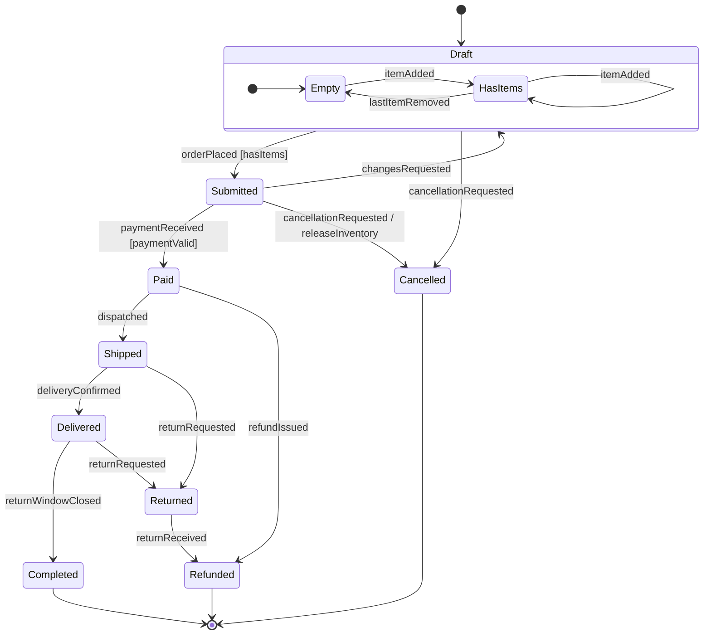
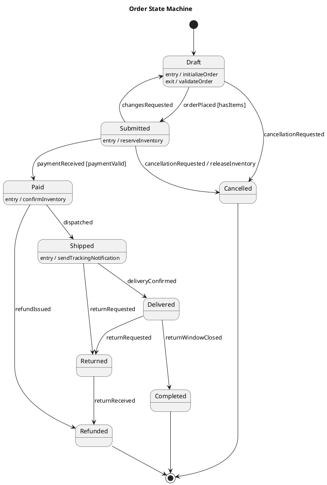

# Documenting a State Machine

How to write the specification for a machine once it is designed. The document is the contract the implementation and its tests are checked against, so it has to be complete before either is written.

## Shape of the document

One document per entity lifecycle, with these sections in order:

1. **Entity**: what has the lifecycle, and which system owns the transitions.
2. **States**: a table of every state with its meaning as a condition, its entry and exit actions, and whether it is initial, terminal, or composite.
3. **Events**: a table of every event with who or what raises it and the payload it carries.
4. **Transition table**: the authoritative list of transitions. The diagram is drawn from this table, never the other way round.
5. **Diagram**: the table rendered visually for review.
6. **Rejected events**: every `(state, event)` pair that is not a transition, with whether it is ignored silently or rejected with an error.

Use the naming rules from `SKILL.md` throughout, so the document, the code, and the tests share one vocabulary.

## Transition table

One row per transition. A transition with a guard gets its own row per guard outcome when the outcomes lead to different states. Substates of a composite state are written `Parent.Child`.

| From | Event | Guard | Action | To |
|------|-------|-------|--------|----|
| Draft.Empty | itemAdded | | | Draft.HasItems |
| Draft.HasItems | itemAdded | | | Draft.HasItems |
| Draft.HasItems | lastItemRemoved | | | Draft.Empty |
| Draft | orderPlaced | hasItems | | Submitted |
| Draft | cancellationRequested | | | Cancelled |
| Submitted | paymentReceived | paymentValid | storePaymentId | Paid |
| Submitted | cancellationRequested | | releaseInventory | Cancelled |
| Submitted | changesRequested | | | Draft |
| Paid | dispatched | | storeTrackingNumber | Shipped |
| Paid | refundIssued | | | Refunded |
| Shipped | deliveryConfirmed | | | Delivered |
| Shipped | returnRequested | | | Returned |
| Delivered | returnWindowClosed | | | Completed |
| Delivered | returnRequested | | | Returned |
| Returned | returnReceived | | | Refunded |

The table is complete when every state appears in the From column or is terminal, every event appears at least once, and every state has a path to a terminal state.

## Diagram notation

Label transitions as `event [guard] / action`. Mark the initial and final states with `[*]`. Nest sub-states inside a composite state rather than flattening them.

### Mermaid

Renders inline in GitHub, Linear, and Notion markdown, so it is the default for documents that live next to the code. Shows composite states well; entry and exit actions go in the states table instead.

### PlantUML

Needs a renderer, but carries entry and exit actions inline on the state, so one diagram can show the whole table.

