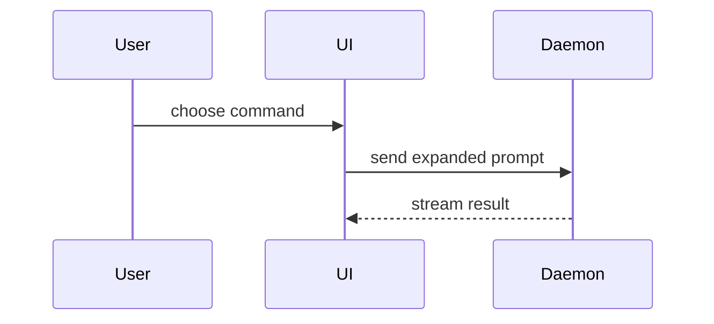

# PR Template Applier

Reads a pull request with `gh`, writes a normalized title and a compact body, and applies them. Optimize for density of insight, not minimum word count: explain why the change matters, what changed, and any consequence a reviewer must understand.

## Workflow

1. **Identify the PR.** Use whichever reference the user supplied: number (`gh pr view 123`), URL, branch, or the current branch (`gh pr view` with no arg). If ambiguous, ask.
2. **Gather.** `gh pr view <ref> --json title,body,headRefName,baseRefName,commits,files,additions,deletions` and `gh pr diff <ref>`. Read the body first and in full — it is the newest version and the only place the author's intent lives. `baseRefName` tells you whether the PR is stacked. Above ~2000 diff lines, sample it: file headers plus a few hunks per file classify the change. Tell the user in the report that the analysis was sampled.
3. **Triage the body against the diff.** See "Triage the body".
4. **Read the ticket and `CONTEXT.md`.** Use `{argument}` for the ticket if given; otherwise search the body and every commit message for `[A-Z]{2,}-\d+` (e.g. `PROJ-456`). Read each ticket you find and treat its description as a claim too — the code is what shipped. Read `CONTEXT.md` if the repo has one (root, or the nearest ancestor directory of the changed files); its terms govern the wording you write.
5. **Build the title and the body** from the rules below.
6. **Compress.** Aim for the length target below. Delete low-value detail instead of packing it into longer sentences. Check the final length and keep any excess only when it earns its place.
7. **Unslop.** Read [`../unslop/SKILL.md`](../unslop/SKILL.md). Apply its process and every pattern check to the title and body, but skip "Adding soul": a PR body states facts without opinion or first person. Preserve verified technical meaning, conventional title syntax, Markdown headings, the `**Door:**` and `**Blast radius:**` labels, literal code, and task-list syntax. This step is complete when the self-audit finds no remaining tell.
8. **Apply.** Pipe the body through stdin. See "Applying the edit". Apply as soon as it is written. `gh pr edit` is re-runnable, so a rewrite the user dislikes costs one more run.
9. **Verify.** Run `gh pr view <ref> --json title,body` and confirm the body is non-empty and opens with `## Problem` or `## Stack`. A mismatch means the apply failed. Retry and tell the user. Report success only after this check passes.
10. **Assign.** `gh pr edit <ref> --add-assignee @me`, plus any login the user named in their instruction.
11. **Report.** Print the applied title and body in a code block, then only what needs the user's judgment: every contradicted claim with its evidence, every claim still unverified, and every gap from the diff audit. When the diff spans unrelated top-level areas, add one line suggesting the PR be split.

## Triage the body

The body is what the author meant to build; the diff is what the code does. Split the body into discrete claims and give each one a verdict before writing a word of the new body.

- **Confirmed** — the diff shows it. Carry it forward in the author's framing, which usually beats one reconstructed from hunks.
- **Contradicted** — the diff shows otherwise. Drop it, and raise it in the report with the evidence: "the body says the retry backs off exponentially; `client.ts:44` retries at a fixed 5s."
- **Unconfirmable** — no diff answers it: a rollout plan, a benchmark result, why an alternative lost. Keep the author's own words and list it in the report as unverified.

A rewrite that launders a stale claim into cleaner prose reads more credible and is equally wrong.

## Title format

`<type>(<scope>): <TICKET-ID> <short description>`

- `<type>` — one of `feat`, `fix`, `refactor`, `perf`, `chore`, `docs`, `test`, `build`, `ci`, `style`, `revert`. Infer from the diff: new feature code → `feat`, bug-fix language in commits → `fix`, doc-only → `docs`, test-only → `test`.
- `<scope>` — a short module or area name from the file paths (`auth`, `api`, `reports`, `ui`). If the change spans many areas, use the dominant one or omit the scope.
- `<TICKET-ID>` — from step 4. When no ticket ID appears in the branch, body, or commits, leave it out: `fix(reports): rewrite dashboard query`.
- `<short description>` — 5–10 words, lowercase, imperative, no trailing period.
- **Breaking change?** Append `!` before the colon: `feat(auth)!: PROJ-456 add OAuth2 PKCE flow`. The title becomes the squash-merge commit message, so the marker belongs there as well as in the body.

## Description format

The diff shows implementation detail. The body gives the reviewer the missing frame: **why this matters, what changed, and what consequences follow**. Keep it compact by removing low-value facts, not by compressing useful ideas into clipped prose.

### Language

Use the ubiquitous language in `CONTEXT.md` when that file exists. The mandatory Unslop pass in step 7 governs punctuation, diction, rhythm, voice, and structure.

Write natural, connected prose. Give each sentence one clear job, but use enough words to show cause and effect. Write each paragraph and each bullet as one unbroken line and let GitHub soft-wrap it. Newlines separate paragraphs, bullets, and headings.

### Length target

Most PR bodies should land between 150 and 250 words after stripping Markdown syntax. Headings and checklist text count. Preserved image URLs, literal command blocks, and shape sketches in code fences do not count.

This range is a default, not a cap. A larger body earns its length when the PR has several distinct behaviors, a migration or rollout, a breaking contract, cross-system effects, or risks that reviewers must evaluate. Diff size alone does not justify more prose. Every sentence beyond the range must answer a concrete reviewer question that the shorter version leaves open.

Compression removes content. It does not join discarded facts into dense compound sentences. Keep the causal chain, behavioral changes, strongest test evidence, material scope boundaries, and required human actions. Drop secondary implementation detail, exhaustive cases, repeated consequences, unchanged behavior, and facts a reviewer can read directly from the diff.

Use these defaults as the first editing pass:

- `Problem`: usually one paragraph and no more than 4 sentences.
- `Fix`: usually no more than 5 one-sentence bullets.
- `Tests`: usually no more than 4 one-sentence bullets.
- `Not in this PR`: usually no more than 2 one-sentence bullets.
- `Merge danger`: two labelled bullets, each one sentence.
- `Pre-merge checklist`: usually no more than 2 items.

Break a default when following it would hide information needed to review or ship the change safely. Above 250 words, challenge every extra bullet and sentence. Never preserve a detail by making another sentence harder to read.

### Sections

Use these sections in this order. Every optional section waits for its trigger.

**`## Stack`** — Only when `baseRefName` is not `main`/`master`, or the body or commits say "stacked on", "depends on", "split out of". First position: merge order is the reviewer's most urgent context. Use one framing sentence and usually no more than 2 bullets — what it is **stacked on** (the PR number, the merge order) and any **sibling PR** split from the same branch. Note that GitHub retargets this PR to the default branch once the parent merges.

**`## Problem`** — Every PR. Explain the failure, need, or constraint before the solution. Trace the causal chain far enough that a reviewer understands both the mechanism and the user or operational consequence. Keep implementation changes out of this section.

**`## Fix`** — Every PR. Use plain bullets for substantive changes. Each bullet describes one coherent behavior, contract, or decision and explains its important consequence. Order the bullets along the runtime or user flow when one exists. A small change may use one short paragraph instead. When the change is structural — a new call path, a moved module boundary, a changed component or file layout — open the section with a shape sketch (see "Shape sketches") and keep the bullets for the consequences the sketch cannot show.

**`## Breaking changes`** — Only when the diff shows one: removed public exports, changed public signatures, renamed or removed endpoints, removed CLI flags, schema removals, a major version bump, or a `BREAKING:` marker. State what breaks and how callers migrate.

**`## Tests`** — Include for code changes when the diff or existing body provides test evidence. Use plain bullets that name the behavior proved, including the main success case and the highest-risk boundary. Combine related assertions. Prefer before-and-after evidence: the exact test or command that failed and now passes, or output captured on each side. Include commands only when they were run. For a visual change, before-and-after screenshots from the original body outrank any prose here; carry them in `## Screenshots`.

**`## Not in this PR`** — Only when a material scope boundary, operational follow-up, unresolved decision, or known affected population could surprise a reviewer. Use plain bullets. State what remains, why it remains, and where it is tracked when known. Omit this section when there is no meaningful boundary.

**`## Merge danger`** — Every code change. Two labelled bullets. `**Door:**` is `one-way` or `two-way`: a change that a revert fully undoes is a two-way door; a destructive migration, a wire format consumers adopt on sight, or a decision that is hard to reverse once data flows through it is a one-way door. `**Blast radius:**` is a short phrase naming the widest thing that breaks if the change is wrong: a query's callers, layout on every page, each consumer of a schema. Add a second sentence to either bullet only when the label alone would mislead.

**`## Pre-merge checklist`** — See "Pre-merge checklist". Usually no more than 2 items, all unchecked.

**`## Screenshots`** — Only when the original body already holds images or video links. Carry them through unchanged, at the bottom. Generate nothing here.

Keep the section set small by omitting optional sections, not by collapsing distinct reviewer questions into one paragraph. Remove file inventories, low-value implementation trivia, and repeated facts. Spend words where they add insight, then stop.

Name collaborators in assignees. Write any `@`-mention from the original body as plain text — GitHub re-notifies mentioned users on every edit.

### Shape sketches

A sketch shows the shape of a structural change in fewer words than bullets can. Pick the smallest view that makes the point, place it right after the sentence it supports, and cut every call, file, prop, or state the reviewer does not need. One sketch is usual, several is rare, and all of them is never.

- Logic or an algorithm as pseudocode.
- Runtime control flow as a call tree.
- UI structure as a component tree, marking the state hooks and module boundaries that matter.
- File responsibility or a broad refactor as a shallow file tree with one comment per entry.
- Component interaction or data flow as a Mermaid `sequenceDiagram`.
- A change to any of these as a `diff` of that shape, when the surrounding structure already exists and the point is what moved.
- The whole block as code when most of it is new, when omitted context would hide ownership or order, or when the reviewer needs a copyable target shape.

A component tree:

```text
<SessionPage>                 apps/example/src/routes/session.tsx
  useSessionEvents()
  <SessionToolbar>
    <RunSkillButton>          packages/ui
```

A data-flow sketch:



A call-tree diff:

```diff
 submitForm
   createSession
     persistPrompt
+    expandSkillMention
     launchAgent
   navigateToSession
+    subscribeToEvents
```

A file-layout diff:

```diff
 src/
 ├── commands/
+│   └── show-me.ts       # expands the slash command
 ├── sessions/
-└── transport.ts
+└── transport/
+    ├── client.ts
+    └── stream.ts
```

A control-flow diff:

```diff
 on(save)
-  write content
+  if content is unchanged
+    return cached result
+  write new content
+  invalidate cache
```

### Pre-merge checklist

A GitHub task list. Every item is **a human action, before merge, that CI cannot perform, made necessary by this diff.** An action CI can prove is not an item.

Signals that usually produce one:

| Signal in the diff                                              | Item                                                                    |
| --------------------------------------------------------------- | ----------------------------------------------------------------------- |
| Files under `migrations/`, `db/migrate/`, `schema/`, `*.sql`     | Migration run against a production-sized dataset; rollback path verified |
| Schema or wire-format change with consumers outside this repo    | Backward compatibility confirmed with downstream consumers               |
| Auth, crypto, permissions, or secrets handling                   | Security review requested                                                |
| Feature flag references                                          | Flag default and rollout plan documented                                 |
| New env vars or config keys                                      | Deployment configs updated for staging and production                    |
| Behavior only a human can confirm (visual, timing, first-run)    | The exact thing to click through and observe                             |

Paraphrase each item to name the actual change: "Migration tested against a production-sized dataset (drop index is a safe rollback)", not the generic wording. Usually keep the two highest-risk items. Add more only when each additional action is independently necessary before merge. Most PRs fire nothing — then the section is omitted.

### Diff audit

You hold the full diff, so settle these yourself during generation. Findings go in the report, never in the body.

| Signal in the diff                                                | Verify in the diff                  |
| ------------------------------------------------------------------ | ----------------------------------- |
| New non-trivial logic                                              | Matching test changes accompany it  |
| Changed public signatures, exported symbols, or removed CLI flags  | All in-repo callers updated         |
| Changed public routes or exported handlers                         | Docs / OpenAPI updated in this diff |

A gap is a question for the chat: "new logic in `auth/pkce.ts` ships with no test changes — gap, or covered elsewhere?" It reaches the body as a checklist item only when the user asks to track it.

## Worked examples

### Example 1 — the typical PR

**Input:** Body mentions `PROJ-892`. Diff: one query rewrite in `reports/queries.ts` plus coverage for large workspaces and result ordering. No migration, no UI, no public API change.

**Output title:** `fix(reports): PROJ-892 rewrite dashboard query to use the events index`

**Output body:**
```markdown
## Problem
Reports become unusable for large workspaces because the dashboard sorts every event in memory and times out.

## Fix
- Read reports from the existing `events(workspace_id, created_at)` index.
- Remove the in-memory sort while keeping the current reporting path.

## Tests
- The large-workspace report completes with the indexed query and preserves the existing result order.

## Merge danger
- **Door:** two-way. A revert restores the in-memory sort.
- **Blast radius:** dashboard report results in every workspace.
```

That is the whole body. Each section answers one reviewer question, and the bullets make the change easy to scan. A query rewrite has no shape worth sketching, no migration files means no checklist, and no contract change means no `Breaking changes`.

### Example 2 — a larger PR

**Input:** Branch `feature/oauth-pkce`, base `feature/oauth-be`, commits reference `PROJ-456`. Diff adds an authorization code path with tests in `auth/pkce.test.ts`, modifies the `/oauth/authorize` handler, removes the ability to call it without a code challenge, and adds an `OAUTH_PKCE_REQUIRED` env var. Existing public clients migrate in separate repositories.

**Output title:** `feat(auth)!: PROJ-456 add OAuth2 PKCE flow`

**Output body:**
````markdown
## Stack
Client half of the PKCE work, split from the combined branch.
- **Stacked on #4666.** This PR uses its token-exchange contract. Merge #4666 first. GitHub then retargets this PR to `main`.

## Problem
An intercepted redirect can expose an authorization code from a public OAuth2 client. An attacker can use that code because nothing binds it to the client that started the request.

## Fix
```diff
 /oauth/authorize
+  requireCodeChallenge
 /oauth/token
+  verifyCodeVerifier
+  verifyClientSecret
```
- Require a PKCE challenge on each authorization request.
- Verify the matching client secret during token exchange.
- Gate enforcement with `OAUTH_PKCE_REQUIRED` while public clients migrate.

## Breaking changes
`/oauth/authorize` rejects requests without a `code_challenge`. Public clients must send one before enforcement, or they get `400 invalid_request`.

## Tests
- Authorization accepts a valid challenge and verifier pair.
- Token exchange rejects a missing or mismatched verifier.

## Not in this PR
- Existing public clients still need separate changes to send a PKCE challenge.

## Merge danger
- **Door:** two-way while `OAUTH_PKCE_REQUIRED` is off. Turning it on rejects every client that has not migrated, and turning it back off is the rollback.
- **Blast radius:** every public OAuth client that has not adopted PKCE.

## Pre-merge checklist
- [ ] Security review requested for the new authorization code path
- [ ] `OAUTH_PKCE_REQUIRED` set in staging and production before deploy
````

The body separates the security failure, implementation, compatibility break, test evidence, rollback story, and remaining human actions. The call-tree diff shows where enforcement lands, and the bullets carry the consequences the sketch cannot. The missing API documentation goes in the report, not into a box.

## Applying the edit

Pipe the body to `gh pr edit` through stdin with a heredoc:

```bash
gh pr edit <ref> --title "<the generated title>" --body-file - <<'EOF'
<the generated body>
EOF
```

Stdin sidesteps two failure modes: shell quoting of multi-line content, and zsh `noclobber`. Avoid `mktemp` + `cat > "$BODY_FILE"` — `noclobber` rejects the redirect to the file `mktemp` just created, the body file stays empty, and `gh pr edit` pushes an empty body. The verify step is what catches this, so run it every time.

## Assignees

Collaborators are assignees, set with `gh pr edit`. `@me` belongs in the `--add-assignee` flag, never in body text.

- **Self:** `gh pr edit <ref> --add-assignee @me`. Always safe, always do it.
- **Anyone else:** run `--add-assignee <login>` only for a login the user named in their instruction. An assignment notifies that person, so a name found in the original body is a suggestion for the report, not an assignment.

Resolve a candidate against the logged-in account with `gh api user --jq .login`. When `--add-assignee` fails because the user is not a collaborator, tell the user.

## Edge cases

- **No ticket found:** leave the ticket ID out of the title and write the rest of it normally.
- **Several ticket IDs match:** prefer the one in the branch name, then the first in commits.
- **User wants a change after the apply:** honor the adjustment and re-apply. A dropped item stays dropped through later rewrites.
